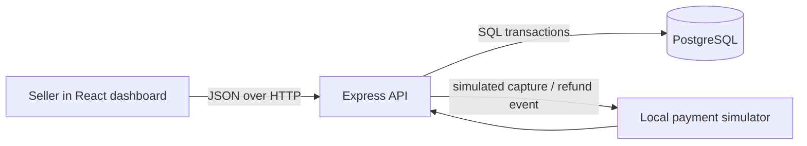

# MerchantFlow architecture

MerchantFlow is a local portfolio application for exploring order and payment state. The browser app talks to one JSON API, and the API stores state in PostgreSQL. A local simulator stands in for a payment provider; it never handles card details or real funds.

## Order creation

1. The client sends a product ID and quantity with an `Idempotency-Key`.
2. The API stores a hash of those normalized inputs. Reusing the key with the same inputs returns the saved order response; using it with different inputs returns `409 Conflict`.
3. In one database transaction, the API locks the product row, checks available stock, reserves the requested quantity, creates the pending order, and stores the replay response.
4. A failed transaction rolls all of those writes back together.

## Payment events

The simulator submits a capture or refund with a unique event ID. The API locks the order, records the event ID, changes order/payment state, and inserts a debit/credit pair in one transaction. A repeat event ID returns the existing result without adding another payment or ledger pair. An event ID reused with different event data is rejected.

Cancellation is available only while an order is pending. It changes the order state and releases the reserved quantity in the same transaction. Capture, refund, and cancellation contend on the order row so two state changes cannot both win.

## Data rules

- Prices and order totals are integer paise, stored in PostgreSQL integer columns.
- Database checks protect positive prices and amounts, non-negative stock, allowed states, and unique idempotency/event identifiers.
- The ledger records equal debits and credits for each simulated capture or refund.
- The API returns generic messages for unexpected server errors and does not expose stack traces to clients.

## Verification

The API integration suite uses PostgreSQL and covers validation, idempotent order replay, duplicate event delivery, inventory release on cancellation, concurrent orders against scarce inventory, and capture/refund ledger consistency. The browser project has unit tests for INR-to-paise conversion and a production build in CI.

## Boundaries

This is a learning system. It has no user authentication, real payment provider, provider signature verification, settlement, or production deployment configuration. The simulator can be disabled with `SIMULATOR_ENABLED=false`; it should not be exposed as a public payment service.

